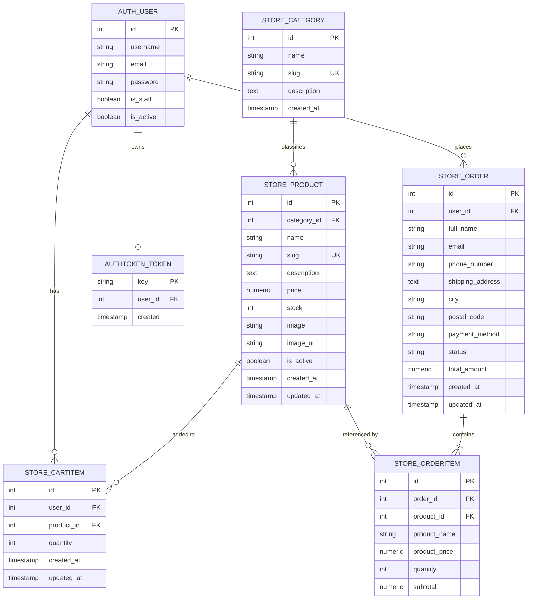

# 05 - PostgreSQL Database Guide: SHOPNEST

This guide details the PostgreSQL database design, relational tables, constraints, keys, and how Django's Object-Relational Mapper (ORM) executes SQL queries against the database.

---

## 1. Database Creation & Configuration

In PostgreSQL, the SHOPNEST database is configured with the following parameters (stored in `backend/.env`):

```ini
DB_NAME=ecommerce
DB_USER=postgres
DB_PASSWORD=your_password
DB_HOST=localhost
DB_PORT=5432
```

### PostgreSQL CLI Command to Create Database:
```sql
CREATE DATABASE ecommerce;
```

---

## 2. Entity-Relationship (ER) Diagram



---

## 3. Database Tables Breakdown

### 1. `store_category`
- **`id` (SERIAL PRIMARY KEY)**: Auto-incrementing unique identifier.
- **`name` (VARCHAR(100) UNIQUE)**: Category display title.
- **`slug` (VARCHAR(120) UNIQUE)**: URL-safe slug with database index for fast lookups.

### 2. `store_product`
- **`id` (SERIAL PRIMARY KEY)**
- **`category_id` (INTEGER REFERENCES store_category(id) ON DELETE CASCADE)**: Foreign key pointing to category.
- **`price` (NUMERIC(10, 2))**: Decimal price preventing floating point rounding errors.
- **`stock` (INTEGER CHECK (stock >= 0))**: Non-negative integer representing physical stock available in warehouse.
- **`is_active` (BOOLEAN)**: Soft toggle allowing products to be archived without breaking foreign key references in historical orders.

### 3. `store_cartitem`
- **`id` (SERIAL PRIMARY KEY)**
- **`user_id` (INTEGER REFERENCES auth_user(id) ON DELETE CASCADE)**
- **`product_id` (INTEGER REFERENCES store_product(id) ON DELETE CASCADE)**
- **`quantity` (INTEGER CHECK (quantity >= 1))**
- **CONSTRAINT `store_cartitem_user_id_product_id_uniq` UNIQUE (user_id, product_id)**: Guarantees that each user has at most one cart item row per product.

### 4. `store_order`
- **`id` (SERIAL PRIMARY KEY)**
- **`user_id` (INTEGER REFERENCES auth_user(id) ON DELETE CASCADE)**
- **`full_name`, `email`, `phone_number`, `shipping_address`, `city`, `postal_code`**: Customer delivery information.
- **`payment_method` (VARCHAR(20))**: Default `'COD'` (Cash on Delivery).
- **`status` (VARCHAR(20))**: Current order state (`Pending`, `Processing`, `Shipped`, `Delivered`, `Cancelled`).
- **`total_amount` (NUMERIC(10, 2))**: Exact monetary sum due on delivery.

### 5. `store_orderitem`
- **`id` (SERIAL PRIMARY KEY)**
- **`order_id` (INTEGER REFERENCES store_order(id) ON DELETE CASCADE)**
- **`product_id` (INTEGER REFERENCES store_product(id) ON DELETE SET NULL)**: Nullable in case a product is deleted from the catalog.
- **`product_name` (VARCHAR(200))**: Frozen snapshot of product name at purchase time.
- **`product_price` (NUMERIC(10, 2))**: Frozen unit price at purchase time.
- **`quantity` (INTEGER)**
- **`subtotal` (NUMERIC(10, 2))**: Product price multiplied by quantity.

---

## 4. How Django ORM Translates Python into SQL

Django ORM bridges Python code and PostgreSQL SQL queries:

### Example 1: Filtering Products by Category and Search Term
**Python (ORM):**
```python
Product.objects.filter(is_active=True, category__slug='electronics', name__icontains='headphone')
```
**Generated PostgreSQL SQL:**
```sql
SELECT
    store_product.id,
    store_product.category_id,
    store_product.name,
    store_product.slug,
    store_product.description,
    store_product.price,
    store_product.stock,
    store_product.image,
    store_product.image_url,
    store_product.is_active,
    store_product.created_at,
    store_product.updated_at
FROM store_product
INNER JOIN store_category ON (store_product.category_id = store_category.id)
WHERE store_product.is_active = TRUE
  AND store_category.slug = 'electronics'
  AND store_product.name ILIKE '%headphone%';
```
*(Notice how Django ORM uses PostgreSQL's native case-insensitive `ILIKE` operator for `__icontains`.)*

### Example 2: Atomic Checkout & Stock Decrement
**Python (ORM):**
```python
product = Product.objects.get(id=1)
product.stock -= 2
product.save(update_fields=['stock'])
```
**Generated PostgreSQL SQL:**
```sql
UPDATE store_product
SET stock = stock - 2
WHERE id = 1;
```

### Example 3: Fetching Orders with Prefetched Items (Avoiding N+1 Query Problem)
**Python (ORM):**
```python
orders = Order.objects.filter(user=request.user).prefetch_related('items')
```
- In naive ORM code, querying 10 orders and then iterating over each order's items results in 1 query for orders + 10 queries for items (11 queries total: the classic **N+1 problem**).
- By using `.prefetch_related('items')`, Django executes exactly **2 SQL queries**:
  1. `SELECT * FROM store_order WHERE user_id = 5;`
  2. `SELECT * FROM store_orderitem WHERE order_id IN (1, 2, 3, ...);`
- Django then matches them in Python memory, drastically improving performance!
